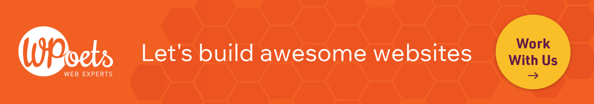

	

# WPoets — Your WordPress Experts
## Enterprise Websites, Simplified for Marketers

We build fast, reliable enterprise WordPress websites for marketing teams.  
We also open-source the tools we use.

**Awesome Enterprise** is our shortcode-based low-code platform for PHP and WordPress. It lets technical teams build custom workflows, integrations, and internal tools without heavy page builders.

### What we open-source

| Project | Description | Link |
|---------|-------------|------|
| **Awesome Enterprise** | Core low-code platform for PHP/WordPress | [awesome-enterprise](https://github.com/WPoets/awesome-enterprise) |
| **Awesome XP** | No-code / low-code version | [awesome-xp](https://github.com/WPoets/awesome-xp) |
| **Awesome Enterprise WP** | WordPress plugin that enables editing & low-code flows | [awesome-enterprise-wp](https://github.com/WPoets/awesome-enterprise-wp) |
| **Monomyth** | Blank / FSE themes designed for Awesome Enterprise | [monomyth-fse](https://github.com/WPoets/monomyth-fse) · [monomyth-enterprise](https://github.com/WPoets/monomyth-enterprise) |
| Handlers | Excel, PDF, Google, FluentCRM, Communication, etc. | Search the org for `*-handler` |

Docs → [awxdocs.com](https://awxdocs.com/)  

### What we do for clients

- Enterprise WordPress websites & portals  
- Migrations (Webflow, Drupal, Sitecore, AEM, custom, etc.) with SEO intact  
- Core Web Vitals & performance optimization  
- Fully managed hosting, maintenance, and support  

### Connect
🙋 Say hello on [Twitter](https://x.com/wpoets) or [Linkedin](https://www.linkedin.com/company/wpoets). 
👩‍💻 Follow us on [Instagram](https://www.instagram.com/wpoetswebexperts/) or [YouTube](https://www.youtube.com/@WPoetsWebExperts). 
🌍 Visit [Website](https://www.wpoets.com/).

Pune, India · We're hiring → see individual repos or the website

